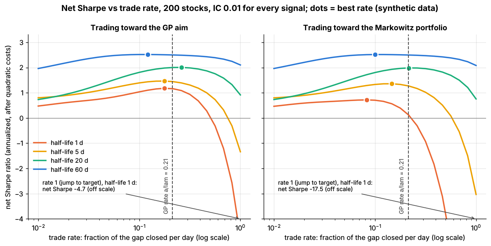
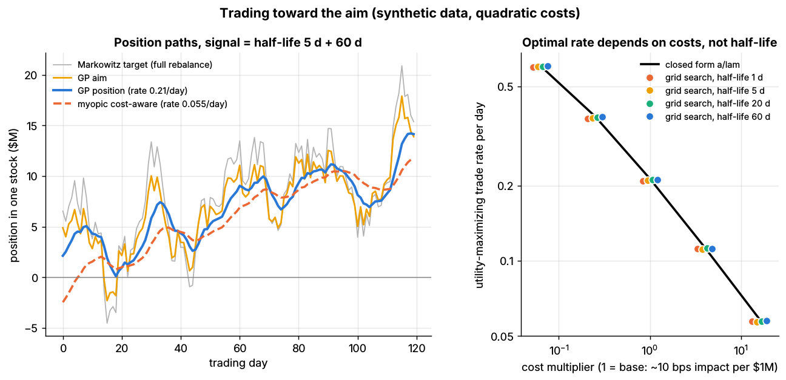

# Lab 15: Trading toward the aim (Gârleanu-Pedersen)

## What it demonstrates

- **The Gârleanu & Pedersen (2013) result.** Suppose returns are predictable from signals that
  decay at known rates, and trading costs are quadratic (`cost = 1/2 * lam * dx' Sigma dx`, so
  impact grows with trade size). Then the optimal policy is to trade a **fixed fraction of the
  way toward an "aim" portfolio** every day:

  ```python
  def trade_toward_aim(current, aim, rate):
      return current + rate * (aim - current)          # rate = a / lam

  def gp_trade_rate(gamma, lam, rho=0.0):              # closed form from the paper
      g = gamma * (1 - rho) + lam * rho
      a = (-g + sqrt(g**2 + 4 * gamma * lam * (1 - rho)**2)) / (2 * (1 - rho))
      return a / lam

  # aim = sum over signals k of  Markowitz_k / (1 + a * phi_k / gamma),
  # where Markowitz_k = alpha_k / (gamma * sigma^2) and phi_k = 1 - daily persistence
  ```

  The **rate depends only on costs (`lam`) and risk aversion (`gamma`)**: higher costs mean slower
  trading. Signal persistence enters through the **aim**. The aim shrinks fast-decaying signals,
  because their alpha will be gone before the position is built, and leaves persistent signals
  almost untouched.
- **The closed form is recovered numerically.** The lab simulates a 200-stock market over 10
  years with four planted alphas of equal IC (0.01) but half-lives of 1, 5, 20 and 60 days. A grid
  search over the trade rate finds the utility-maximizing rate within about 2% of `a / lam` for every
  half-life and for cost levels spanning a factor of 256.
- **Common shortcut: trade toward the Markowitz portfolio.** If you instead trade toward the plain
  Markowitz portfolio (the frictionless optimum), the best rate **does** depend on the half-life.
  It is 0.06 per day for the 1-day signal and 0.20 for the 60-day signal. The best result is also
  worse: 35% less utility for the 1-day signal and 12% less for the 5-day signal.
- **Pitfall 1: full rebalancing.** Jumping to the Markowitz portfolio every day turns a gross
  Sharpe of about 2.3 into a net Sharpe of −17.5 for the 1-day signal, and −3.0 for the 5-day
  signal.
- **Pitfall 2: myopic optimization.** A single-period cost-aware optimizer maximizes today's
  `alpha'x - gamma/2 x'Sigma x - cost`. That implies trading at rate `gamma / (gamma + lam)`, which
  is 0.055 per day here, four times too slow. It charges the whole cost of a trade against one
  day of alpha, when the position keeps earning for weeks.

The book is assumed factor-hedged: P&L is positions times **specific** returns, and risk is the
diagonal of specific variances. The trader is given the true signal model (loading, volatility
and decay), so differences between rules come only from how they trade.

## Supports

- [Multi-period optimization and trading toward the aim](../../docs/03-algorithms/d-portfolio-construction/multi-period-and-trading-toward-aim.md)

## How to run

```bash
cd /home/user/quant_trading_claude && export PATH=/home/user/venv-qt/bin:$PATH
python labs/15-trading-toward-aim/lab.py              # full run (~7 s): plots + results.json
python labs/15-trading-toward-aim/lab.py --smoke      # CI run (~2.5 s), writes to labs/_smoke/
python labs/15-trading-toward-aim/lab.py --seed 3     # another simulated market
```

## Expected output

Full run, seed 7: 200 stocks, 2,520 days (the first 120 are dropped). `gamma = 2e-7` per $ and
`lam = 3.46e-6` per $ give a **GP rate of 0.213 per day**, so the gap to the aim halves in about
3 days. The myopic rate is 0.055.

| Signal half-life | Measured IC | Net Sharpe, full rebalance | Net Sharpe, GP | Best net Sharpe toward Markowitz | Utility-max rate toward aim (grid) | Utility-max rate toward Markowitz (grid) | Utility, GP vs best toward Markowitz ($M/yr) |
|---|---|---|---|---|---|---|---|
| 1 day | 0.0096 | −17.5 | 1.16 | 0.72 | 0.209 | 0.064 | 1.67 vs 1.09 |
| 5 days | 0.0092 | −3.0 | 1.44 | 1.36 | 0.210 | 0.139 | 6.19 vs 5.43 |
| 20 days | 0.0102 | 0.76 | 2.00 | 1.99 | 0.211 | 0.190 | 10.66 vs 10.49 |
| 60 days | 0.0106 | 2.08 | 2.50 | 2.52 | 0.212 | 0.204 | 12.44 vs 12.41 |

Utility is the GP objective: expected P&L − γ/2 × variance − costs, computed with the true model.



*Left: trading toward the GP aim. Right: trading toward the Markowitz portfolio. Dots mark each
curve's best rate; the dashed line is the closed-form rate.*

The net-Sharpe peaks sit near, but not exactly at, the GP rate (0.12–0.26), and the curves are
flat near the top. GP maximizes mean-variance utility net of costs, not the Sharpe ratio, and the
Sharpe ratio ignores the size of the book. The utility peaks, in the table, match the closed form.

| Cost multiplier (1 = base) | GP rate `a / lam` | Grid-search rate, four half-lives |
|---|---|---|
| 1/16 | 0.605 | 0.596–0.602 |
| 1/4 | 0.379 | 0.372–0.377 |
| 1 | 0.213 | 0.209–0.212 |
| 4 | 0.113 | 0.112 |
| 16 | 0.058 | 0.057–0.058 |

The grid optimum is consistently about 1–2% below the closed form, probably because the simulator's
volatility varies over time while the formula assumes a constant `Sigma`.

Combined signal (half-lives 5 + 60 days), base costs:

| Rule | Rate | Net Sharpe | Gross Sharpe | Utility ($M/yr) | Costs ($M/yr) | Turnover (× gross/yr) |
|---|---|---|---|---|---|---|
| Full rebalance to Markowitz | 1 | −0.71 | 3.46 | −40.3 | 67.4 | 95 |
| Myopic cost-aware | 0.055 | 2.74 | 2.80 | 15.1 | 0.7 | 13 |
| Toward Markowitz at the GP rate | 0.213 | 2.78 | 3.17 | 17.1 | 5.6 | 31 |
| **Gârleanu-Pedersen (aim, GP rate)** | 0.213 | **2.93** | 3.16 | **18.6** | 2.9 | 26 |



*Left: one stock's position. The Markowitz target jumps every day. The aim is smoother because it
down-weights the 5-day signal. The GP position closes 21% of the gap daily, and the myopic
position lags far behind. Right: utility-maximizing rate vs cost level; the grid-search points
for all four half-lives sit on the closed-form line.*

Sharpe ratios are those of a **known, non-decaying** signal (IC 0.01 on 200 names) with a
perfectly hedged factor book. Treat the comparisons between rules as the result, not the levels.

## What this toy misses vs the real world

- **Costs are purely quadratic.** Real costs also have a linear part: half-spread, fees and
  commissions. A linear cost creates a no-trade band around the target, which GP's closed form
  does not have. Practitioners combine a band (or an L1 penalty) with partial trading.
- **Costs are proportional to risk.** `Lambda = lam * Sigma` is GP's tractable assumption. Real
  impact scales roughly with volatility divided by liquidity (ADV) for each name, so illiquid
  names should trade more slowly than liquid ones. With a general `Lambda` the rate becomes a
  matrix.
- **Signal decay is known exactly.** A misestimated half-life gives the wrong aim. Overstating the
  persistence of a fast signal reintroduces the overtrading that GP avoids.
- **Risk is diagonal and the book factor-hedged.** With a full factor covariance the aim couples
  names: the hedges are part of the aim, and the formula needs `Sigma^-1`. GP also assume a
  constant `Sigma`, while this simulator, like real markets, has volatility regimes.
- **There are no constraints.** Gross and net limits, position caps, short-borrow availability
  and factor limits break the closed form. Desks then solve a multi-period (model-predictive)
  convex problem each day, often with a GP-style aim as the target.
- **Impact is instantaneous and permanent within the cost term.** Real impact decays after
  trading stops (transient impact), and your own trading erodes the alpha you are chasing,
  especially in crowded signals.
- **Time is daily and discrete, and the signals are synthetic.** Intraday execution of each day's
  trade (Labs 16 and 17) is folded into the single quadratic cost.

## Key parameters

All values are **stylized**. They are chosen for illustration, not calibrated to a particular
market.

| Parameter | Value | Meaning / how chosen |
|---|---|---|
| `n_stocks`, `n_days` | 200, 2,520 | 10 years, to keep Sharpe noise down |
| planted alphas | IC 0.01 each; half-lives 1, 5, 20, 60 days | `horizon_decay = 0.5 ** (1 / half_life)`, so the signal itself is the best predictor |
| expected return | `loading * sigma_i * score` | the simulator's true model, given to the trader |
| `gamma` | 2e-7 per $ | risk aversion; gives a frictionless book of about \$0.86B gross for the combined signal |
| `lam` | 3.46e-6 per $ | trading \$1M of a stock with 1.7% daily specific vol moves it about 10 bps (cost about 5 bps) `[Estimate]`, the same order as square-root-law estimates for a stock with \$50–100M ADV |
| `rho` | 0 | daily discount rate (negligible at daily frequency) |
| GP rate | 0.213 per day | `gp_trade_rate(gamma, lam)` |
| rate grid | 25 log-spaced values, 0.01 to 1 | grid search; peak refined by a parabola in log(rate) |
| cost sweep | `lam` × 1/16 to 16 | rate vs cost level |
| burn-in | 120 days | positions start at zero |

Sources. Bibliographic details checked against Crossref (2026-11).

- [Verified] Gârleanu, N. & Pedersen, L. H. (2013). "Dynamic trading with predictable returns and transaction costs." *Journal of Finance* 68(6), 2309–2340. <https://doi.org/10.1111/jofi.12080> (accessed 2026-11)
