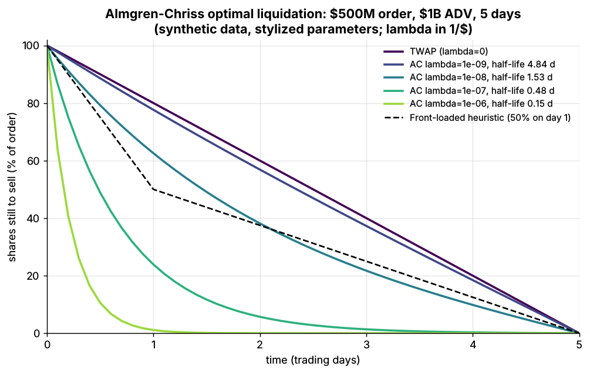
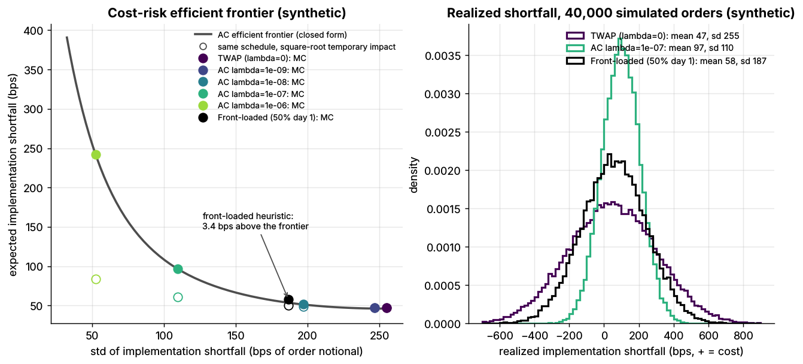

# Lab 16: Almgren-Chriss optimal execution frontier

## What it demonstrates

- The closed-form **Almgren & Chriss (2000)** optimal liquidation trajectory: holdings decay like
  `sinh(kappa (T - t)) / sinh(kappa T)`, where the urgency `kappa = sqrt(lambda sigma^2 / eta)` grows
  with risk aversion `lambda`. `lambda = 0` gives TWAP (a straight line).
- The **efficient frontier** of expected implementation shortfall (IS) vs its standard deviation,
  traced by sweeping `lambda`, for an illustrative **\$500M sell order in a stock with \$1B ADV**
  (50% of ADV, 5 trading days).
- A **Monte Carlo** of 40,000 simulated orders per schedule (common random numbers) for TWAP, AC at
  four `lambda` values and a front-loaded heuristic (50% on day 1). The closed-form mean and variance
  are recovered, and the heuristic lands just above the frontier: it is dominated.
- **Pitfalls:** (1) one order's realized shortfall is mostly price noise, so TWAP beats a risk-averse
  AC schedule on 61% of individual orders even though AC cuts tail risk sharply; (2) the linear
  impact model badly overstates the cost of fast schedules if true temporary impact is concave
  (square-root-like), and the most risk-averse schedule asks for a trading rate of 181% of ADV per
  day in its first interval, which no desk would accept.

## Supports

- [Implementation shortfall and Almgren-Chriss](../../docs/03-algorithms/e-execution-algorithms/implementation-shortfall-and-almgren-chriss.md)

## How to run

```bash
cd /home/user/quant_trading_claude && export PATH=/home/user/venv-qt/bin:$PATH
python labs/16-almgren-chriss-frontier/lab.py              # full run (~1.5 s): plots + results.json
python labs/16-almgren-chriss-frontier/lab.py --smoke      # CI run (~1 s), writes to labs/_smoke/
python labs/16-almgren-chriss-frontier/lab.py --seed 3     # another Monte Carlo seed
```

## Expected output

Full run, seed 7. Costs are in bps of the \$500M order notional (1 bp = \$50,000); `+` = cost.

| Schedule | E[IS] closed form | sd closed form | MC mean | MC sd | MC p95 | E[IS] if impact is square-root | Peak rate (% ADV/day) |
|---|---|---|---|---|---|---|---|
| TWAP (`lambda = 0`) | 46.0 | 254.3 | 46.9 | 255.1 | 465 | 46.9 | 10 |
| AC `lambda = 1e-9` (half-life 4.8 d) | 46.1 | 245.8 | 46.9 | 246.6 | 451 | 46.9 | 12 |
| AC `lambda = 1e-8` (half-life 1.5 d) | 51.3 | 196.8 | 52.0 | 197.2 | 377 | 48.6 | 23 |
| AC `lambda = 1e-7` (half-life 0.48 d) | 96.1 | 109.9 | 96.6 | 109.6 | 277 | 60.8 | 67 |
| AC `lambda = 1e-6` (half-life 0.15 d) | 241.8 | 52.4 | 242.0 | 52.3 | 328 | 83.9 | 181 |
| Front-loaded (50% on day 1) | 57.0 | 186.2 | 57.6 | 186.7 | 365 | 50.1 | 25 |

- **Recovery of the closed form:** the MC means are within 0.87 standard errors of the formula and
  the MC standard deviations within 0.3% (`mc_mean_max_error_in_standard_errors`,
  `mc_sd_max_relative_error`).
- **TWAP cost decomposition:** 25.0 bps permanent impact (`gamma X / 2`) + 19.5 bps temporary impact
  + 1.5 bps half-spread = **46.0 bps, about \$2.3M**, but with a 254 bps (about \$12.7M) standard
  deviation: over 5 days, price risk dwarfs impact cost.
- **The trade-off:** AC with `lambda = 1e-7` roughly doubles expected cost (96 vs 46 bps) but cuts
  the standard deviation from 254 to 110 bps and the 95th-percentile shortfall from 465 to 277 bps.
- **Heuristics are dominated:** the front-loaded schedule costs **3.4 bps more** than the AC
  schedule with the same risk.
- **Pitfall, noise:** on a single order TWAP beats AC (`lambda = 1e-7`) **61%** of the time. You
  cannot judge an execution algorithm from one trade, or even a handful.
- **Pitfall, model error:** under square-root temporary impact (equal to the linear model at the
  TWAP rate), the fastest schedule costs **84 bps, not 242**; the linear model's frontier is wrong
  exactly where risk-averse schedules live.





## What this toy misses vs the real world

- **Impact is linear, permanent plus instantaneous.** Measured impact is concave in size (square-root
  law; Almgren et al. 2005 estimated a temporary-impact exponent near 0.6) and transient: it decays
  after trading stops (Obizhaeva & Wang 2013; Gatheral 2010). Concave impact makes fast trading
  cheaper than this model says, and transient impact makes the optimal schedule depend on resilience.
- **Prices follow arithmetic Brownian motion with constant volatility in trading time.** There is no
  intraday U-shape in volume and volatility, no overnight gap (for a 5-day order, overnight risk is a
  big share of the total), no jumps and no news.
- **There is no alpha and no information leakage.** If the price is expected to drift against you
  (informed order, momentum, other sellers in the same name), the optimal schedule front-loads
  regardless of `lambda`. Leakage from a predictable schedule invites front-running.
- **The schedule is static.** Real IS algorithms re-optimize as prices, liquidity and fills arrive;
  adaptive schedules can beat the static optimum in mean-variance terms (Almgren & Lorenz 2007).
- **`lambda` is not observable.** Desks pick an urgency level (or a participation band, or a target
  completion time) rather than a utility parameter; translating client preferences into `lambda` is
  a judgment call.
- **No participation caps, limit prices, auctions or venues.** Real orders are capped at roughly
  10–30% of volume, use the closing auction for a large share of volume, and are split into child
  orders routed across lit and dark venues (see Lab 17 and Lab 18).
- **Parameters are known exactly.** In practice `eta` and `gamma` are estimated from noisy TCA data
  with wide error bars; a factor-of-2 error in `eta` moves every point on the frontier.

## Key parameters

All parameters are **illustrative and stylized**, chosen to be internally consistent with a
square-root impact law. They are not a calibration to any real stock.

| Parameter | Value | Meaning / how chosen |
|---|---|---|
| `S0` | \$50 | arrival price |
| ADV | 20M shares (\$1B/day) | stock's average daily volume |
| `X` | 10M shares (\$500M) | order size: 50% of ADV |
| `T`, `n` | 5 days, 50 intervals | 10 intervals per day (about 39 minutes each) |
| `sigma` | 2% per day = \$1.00/share/sqrt(day) | about 32% annualized, typical of a large-cap stock `[Estimate]` |
| `epsilon` | 1.5 bps = \$0.0075/share | half of a 3 bps quoted spread `[Estimate]` |
| `eta` | 5e-8 \$/share per (share/day) | temporary impact of 20 bps when trading at 10% of ADV per day (the TWAP rate) |
| `gamma` | 2.5e-8 \$/share per share | permanent impact of 50 bps once the full order (50% of ADV) is done |
| `lambda` | 0, 1e-9, 1e-8, 1e-7, 1e-6 per \$ | risk aversion; urgency half-lives of infinity, 4.8, 1.5, 0.48 and 0.15 days |
| MC paths | 40,000 (smoke: 2,000) | common random numbers across schedules |

How the impact parameters were chosen `[Estimate]`:

- **Square-root law** `[Reported]`: peak impact of a metaorder is about `Y * sigma_daily * sqrt(Q / ADV)`
  with `Y` of order 1 (Tóth et al. 2011; Almgren et al. 2005). With `Y = 0.5` and `sigma = 2%`:
  - **one day at 10% of ADV:** peak impact 32 bps. Average fill cost for a constant-rate square-root
    profile is 2/3 of the peak, about 21 bps. The linear model here charges 25 bps for that order
    (5 bps permanent + 20 bps temporary);
  - **the full order (50% of ADV):** peak impact 71 bps. If impact then relaxes to about 2/3 of its
    peak, the permanent effect is about 47 bps, close to the 50 bps used for `gamma`. Empirical work
    (Zarinelli et al. 2015) and theory (Farmer et al. 2013) suggest relaxation of roughly this size. `[Reported]`
- **Almgren & Chriss (2000) rule of thumb**, paraphrased from their worked example: set `gamma` so
  that trading 10% of daily volume moves the price by one bid-ask spread, and set `eta` so that
  trading 1% of daily volume in a day costs one spread. For this stock (3 bps spread) that gives
  `gamma = 7.5e-9` and `eta = 7.5e-8`. With today's narrow spreads, this rule implies far less
  permanent impact than square-root-law estimates, so the lab anchors to the square-root law
  instead. `[Reported]` (paraphrase of the paper's example).

Sources. Bibliographic details checked against Crossref (2026-11).

- [Verified] Almgren, R. & Chriss, N. (2000). "Optimal execution of portfolio transactions." *Journal of Risk* 3(2), 5–39 (usually cited as 2000; the DOI carries 2001). <https://doi.org/10.21314/JOR.2001.041> (accessed 2026-11)
- [Verified] Almgren, R., Thum, C., Hauptmann, E. & Li, H. (2005). "Equity market impact." *Risk* 18(7), 57–62 (preprint title "Direct estimation of equity market impact").
- [Verified] Tóth, B., Lempérière, Y., Deremble, C., de Lataillade, J., Kockelkoren, J. & Bouchaud, J.-P. (2011). "Anomalous price impact and the critical nature of liquidity in financial markets." *Physical Review X* 1, 021006. <https://doi.org/10.1103/PhysRevX.1.021006>
- [Verified] Bacry, E., Iuga, A., Lasnier, M. & Lehalle, C.-A. (2015). "Market impacts and the life cycle of investors orders." *Market Microstructure and Liquidity* 1(2).
- [Verified] Obizhaeva, A. & Wang, J. (2013). "Optimal trading strategy and supply/demand dynamics." *Journal of Financial Markets* 16(1), 1–32.
- [Verified] Gatheral, J. (2010). "No-dynamic-arbitrage and market impact." *Quantitative Finance* 10(7), 749–759.
- [Verified] Almgren, R. & Lorenz, J. (2007). "Adaptive arrival price." In *Algorithmic Trading III*, Institutional Investor Journals.
