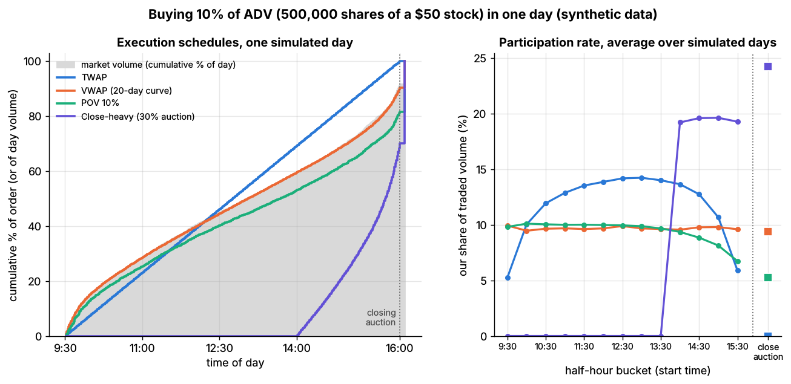
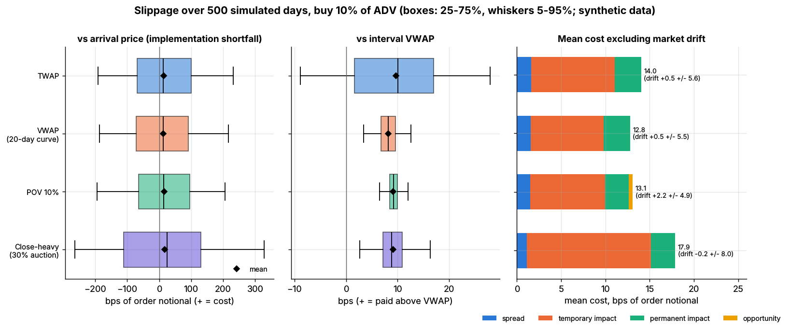

# Lab 17: VWAP, TWAP, POV and the closing auction

## What it demonstrates

- **A one-day buy order for 10% of ADV** (500,000 shares of a \$50 stock, \$25M), executed on 500
  simulated trading days (`simulate_intraday_session`: 390 one-minute bars plus a closing auction
  that carries 10% of the day's volume). Four schedules:
  1. **TWAP:** equal slices every minute of the continuous session;
  2. **VWAP:** slices proportional to a **historical volume curve**, the average of 20 earlier
     days, which includes the closing auction as its last bin;
  3. **POV 10%:** each minute, buy enough to keep our share of printed volume at 10%, using only
     volume already printed. In the closing auction, buy 10% of the indicated auction volume;
  4. **Close-heavy ("target close"):** 30% of the order in the closing auction and the rest along
     the volume curve from 14:00.
- **A stylized cost model**, applied to every child order:
  - pay **half the quoted spread** (no spread in the auction);
  - **temporary impact** `eta * daily_vol * (q / v)^0.6`, where `q / v` is our shares per share
    traded by everyone else in that minute;
  - **permanent impact** `gamma * daily_vol * (shares bought so far / ADV)`, which shifts every
    later price, including other traders' prints.

  In the auction our demand moves the closing price itself.
- **Slippage, decomposed.** **Implementation shortfall** vs the arrival price (Perold 1988) splits
  exactly into five parts: spread, temporary impact, permanent impact, market drift (timing), and
  the opportunity cost of unfilled shares marked at the close. The lab also reports slippage vs
  **interval VWAP** (all prints, ours included, from first to last fill) and vs the **close**,
  plus completion rates.
- **Pitfalls:**
  1. **Schedule risk.** A day's shortfall is dominated by price drift: the standard deviation is
     about 120 bps against expected costs of 13–18 bps.
  2. **The VWAP benchmark moves with you.** It absorbs your permanent impact and your own prints,
     so it hides about a third of the true cost.
  3. **POV does not promise completion.** On below-median-volume days it fills only 88% of the order.
  4. **The "best" algorithm depends on the benchmark.** Close-heavy looks perfect against the close
     and is the most expensive against arrival.

Core functions to mirror in pseudocode: `vwap_schedule(volume_curve, qty)` (TWAP is the flat-curve
case), `pov_child_order(target_rate, market_volume_so_far, executed_so_far, remaining)` and
`child_order_costs_bps(qty, market_volume, half_spread_bps, bought_before, adv, daily_vol, eta, gamma)`.

## Supports

- [VWAP, TWAP and POV](../../docs/03-algorithms/e-execution-algorithms/vwap-twap-pov.md)
- [Execution algorithms: overview](../../docs/03-algorithms/e-execution-algorithms/execution-algorithms-overview.md)

## How to run

```bash
cd /home/user/quant_trading_claude && export PATH=/home/user/venv-qt/bin:$PATH
python labs/17-vwap-twap-pov/lab.py              # full run (~4 s): plots + results.json
python labs/17-vwap-twap-pov/lab.py --smoke      # CI run (~2 s, 40 days), writes to labs/_smoke/
python labs/17-vwap-twap-pov/lab.py --seed 3     # other simulated days
```

## Expected output

Full run, seed 7, 500 test days. All figures are bps of the order's arrival notional; `+` = cost.
1 bp = \$2,500 on this order.

| Strategy | Mean IS | IS sd | IS p95 | Spread | Temp. impact | Perm. impact | Opportunity | **Expected cost** | vs interval VWAP (mean ± sd) | vs close (mean ± sd) | Filled | Participation |
|---|---|---|---|---|---|---|---|---|---|---|---|---|
| TWAP | 14.5 | 125 | 232 | 1.6 | 9.4 | 3.0 | 0.0 | **14.0** | 9.7 ± 11.2 | 11.7 ± 117 | 100% | 10.6% |
| VWAP (20-day curve) | 13.3 | 122 | 217 | 1.5 | 8.3 | 3.0 | 0.0 | **12.8** | 8.2 ± 3.0 | 3.3 ± 104 | 100% | 9.7% |
| POV 10% | 15.3 | 123 | 205 | 1.5 | 8.4 | 2.7 | 0.5 | **13.1** | 9.1 ± 3.2 | 8.9 ± 115 | 93.8% | 10.0% |
| Close-heavy (30% auction) | 17.6 | 180 | 329 | 1.1 | 14.0 | 2.7 | 0.0 | **17.9** | 9.1 ± 3.9 | 0.0 ± 48 | 100% | 19.4% |
| VWAP, perfect volume foresight (reference) | 12.8 | 123 | 218 | 1.5 | 7.8 | 3.0 | 0.0 | 12.3 | 7.7 ± 0.8 | 2.6 ± 103 | 100% | 9.6% |

"Expected cost" is spread + impact + opportunity, i.e. mean IS without the market-drift term. The
drift averages zero in the simulator; its sample mean, ±5–8 bps, is noise. Participation is our
share of continuous-session volume while the order is working.



*Left: cumulative share of the order executed on one simulated day; grey is the market's
cumulative volume. Right: average participation by half-hour bucket and in the closing auction.*

- **VWAP beats TWAP by 1.3 bps of expected cost** because it does not over-participate at midday.
  TWAP's participation runs from about 5% at the open to 14% at lunch. VWAP's tracking error
  against interval VWAP is 3.0 bps, against 11.2 bps for TWAP.
- **Most of VWAP's tracking error is volume-forecast error.** With perfect foresight of the day's
  volume curve, the tracking error drops from 3.0 to 0.8 bps and the cost by 0.5 bps.
- **The VWAP benchmark hides cost.** VWAP's expected cost is 12.8 bps, but it shows only 8.2 bps
  of slippage against interval VWAP. The 3.0 bps of permanent impact also lifts everyone else's
  prints, and our own prints are part of the benchmark.
- **POV adapts to volume but cannot promise completion.** Day volume varies (coefficient of
  variation 0.27), and POV finishes the order on only **61% of days**. On below-median-volume
  days it fills **88%** on average; the rest is opportunity cost and risk carried to tomorrow.
- **The closing auction is cheap liquidity only in moderation.** Close-heavy pays the least
  spread, but 30% of the order is about 23% of auction volume, and the late schedule runs at 19%
  participation. Its expected cost is the highest (17.9 bps) and its arrival risk is the largest
  (sd 180 bps), because it trades far from the arrival time. Yet against the **close** it looks
  perfect (0.0 ± 48 bps), since its own auction demand lifted the closing price it is measured
  against.
- **Schedule risk dwarfs the differences.** A single order's shortfall has a standard deviation of
  about 120 bps. To tell VWAP from TWAP (a 1.3 bps gap) with 2 standard errors by comparing
  realized shortfalls across unrelated orders, for example two brokers, takes about **77,000
  orders**. TCA needs controlled comparisons or cost models, not raw averages.



*Box plots over 500 simulated days (boxes 25–75%, whiskers 5–95%, diamonds = mean). Right: mean
cost by component, with the market-drift mean and its standard error printed.*

## What this toy misses vs the real world

- **Prices are exogenous; impact is an overlay.** Our trades shift prices through a formula, not
  through an order book. Real impact is transient: it decays after trading stops, and it is
  correlated with other traders' flow. The coefficients are stylized, not estimated.
- **Every child order crosses the spread.** Production VWAP and POV algorithms post passively
  much of the time, earning part of the spread but facing fill uncertainty and adverse selection
  (Labs 01, 04 and 18). They also route across lit venues and dark pools.
- **Volume and price are independent.** In real markets volume spikes with volatility and news,
  so a POV algorithm trades most exactly when prices are moving, and VWAP's tracking error
  correlates with returns. Minute volumes here have i.i.d. noise, with no news, events or
  intraday momentum.
- **The volume curve is a plain 20-day average.** Real curves condition on day of week, index
  rebalances, option expiries and earnings. Dynamic VWAP engines also re-forecast the rest of
  the day as volume comes in.
- **The closing auction is one price set by a formula.** Real auctions publish order-imbalance
  information before the close and have cut-off times for market-on-close orders. Offsetting
  interest can absorb an imbalance or amplify it.
- **The schedules are predictable.** A fixed curve with no randomization and no minimum or
  maximum child sizes leaks information that other participants can trade against.
- **Unfilled POV shares are marked at the close.** In reality they are bought the next day, with
  overnight gap risk and more impact.
- **One stock, one day, no alpha.** Multi-day orders, urgency from a short-term signal, and
  risk-averse front-loading are the domain of implementation-shortfall algorithms (Lab 16).

## Key parameters

All values are **stylized**. They are chosen for illustration, not calibrated to a particular
stock.

| Parameter | Value | Meaning / how chosen |
|---|---|---|
| stock | \$50, ADV 5M shares (\$250M), daily vol 2%, quoted spread 3 bps (about 2.5x wider at the open) | `IntradayConfig` defaults |
| `close_auction_share` | 10% of daily volume | closing auction size (lognormal noise around it) |
| order | buy 500,000 shares = 10% of ADV (\$25M) | full day, arrival at the open |
| `eta`, exponent | 0.15, 0.6 | temporary impact: 7.5 bps at `q / v` = 0.10, 11.4 bps at 0.20 `[Estimate]`; the 0.6 exponent follows the 3/5 power law reported by Almgren et al. (2005) |
| `gamma` | 0.30 | permanent impact: 6 bps after buying 10% of ADV, about 3 bps of average cost |
| resulting cost | about 13 bps for a full-day VWAP | `[Estimate]`: on the low side of the square-root law, which with prefactor 0.5 gives about 20 bps for 10% of ADV |
| VWAP curve | mean of 20 earlier simulated days, 391 bins | historical forecast, not smoothed |
| POV rate | 10% of total volume | reacts to volume printed in previous minutes; auction leg uses the indicated auction volume |
| close-heavy | 30% in the auction, 70% on the curve from 14:00 | target-close style |
| test days | 500 (smoke: 40) | independent sessions, day seeds from `--seed` |

Benchmarks follow standard TCA conventions (see Kissell 2014). **Arrival price** is the price when
the order starts; implementation shortfall against it includes the opportunity cost of unfilled
shares (Perold 1988). **Interval VWAP** is the volume-weighted average of all prints, including
ours, between the first and last fill. **Close** is the official closing (auction) price.

Sources. Bibliographic details checked against Crossref (2026-11).

- [Verified] Perold, A. F. (1988). "The implementation shortfall: paper versus reality." *Journal of Portfolio Management* 14(3), 4–9. <https://doi.org/10.3905/jpm.1988.409150> (accessed 2026-11)
- [Verified] Berkowitz, S. A., Logue, D. E. & Noser, E. A. (1988). "The total cost of transactions on the NYSE." *Journal of Finance* 43(1), 97–112 (early use of VWAP as a trading-cost benchmark). <https://doi.org/10.1111/j.1540-6261.1988.tb02591.x> (accessed 2026-11)
- [Verified] Kissell, R. (2014). *The Science of Algorithmic Trading and Portfolio Management*. Academic Press (Elsevier). ISBN 978-0-12-401689-7. <https://doi.org/10.1016/B978-0-12-401689-7.00001-5> (accessed 2026-11)
- [Verified] Kissell, R., Glantz, M. & Malamut, R. (2004). "A practical framework for estimating transaction costs and developing optimal trading strategies to achieve best execution." *Finance Research Letters* 1(1), 35–46. <https://doi.org/10.1016/S1544-6123(03)00004-7> (accessed 2026-11)
- [Verified] Konishi, H. (2002). "Optimal slice of a VWAP trade." *Journal of Financial Markets* 5(2), 197–221. <https://doi.org/10.1016/S1386-4181(01)00023-4> (accessed 2026-11)
- [Verified] Almgren, R., Thum, C., Hauptmann, E. & Li, H. (2005). "Direct estimation of equity market impact." *Risk* 18(7).
