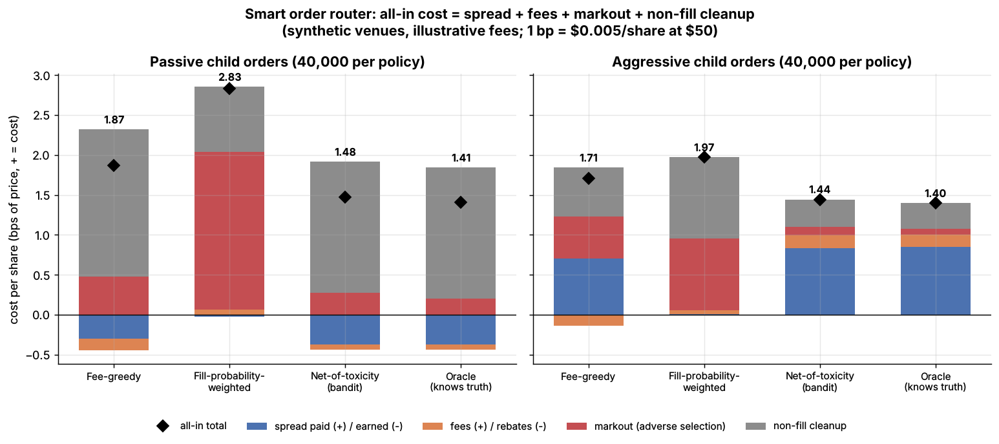
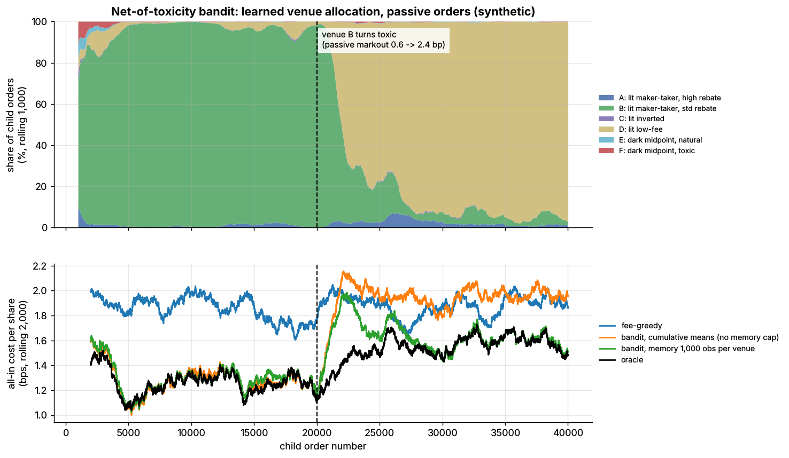

# Lab 18: Smart order router toy

## What it demonstrates

- A toy **smart order router (SOR)** choosing among six stylized US-equity venues: two maker-taker
  lit exchanges (high and standard rebate), an inverted lit exchange, a low-fee lit exchange, and
  two **midpoint dark pools**, one with natural contra flow and one full of fast, toxic flow.
- **All-in cost per share = spread + fees/rebates + markout (post-fill adverse selection) + the
  cost of cleaning up orders that do not fill.** A non-filled passive order must cross the spread
  later, after the price has drifted away. A missed aggressive IOC is re-routed to a lit venue at a
  slightly worse price.
- Four router policies, each run on 40,000 passive and 40,000 aggressive child orders with common
  random numbers:
  1. **fee-greedy**: the best published make or take fee;
  2. **fill-probability-weighted**: learns fill rates online and minimizes expected spread + fees +
     non-fill cost, but ignores markouts;
  3. **net-of-toxicity**: also learns each venue's markout online. It is a bandit that explores by
     Thompson sampling, and its estimates keep a memory of about 1,000 observations per venue;
  4. an **oracle** that knows the true venue parameters (the truth the bandit should recover).
- **Pitfalls:**
  - a high fill rate is often a symptom of toxicity, so the fill-weighted router piles into the toxic
    dark pool;
  - markouts are so noisy that separating venues 0.5 bp apart takes about 770 fills each;
  - a router whose estimates never forget keeps routing to a venue long after its toxicity jumps.
    This is shown by a regime break halfway through the passive run.

## Supports

- [Smart order routing](../../docs/03-algorithms/e-execution-algorithms/smart-order-routing.md)

## How to run

```bash
cd /home/user/quant_trading_claude && export PATH=/home/user/venv-qt/bin:$PATH
python labs/18-smart-order-router/lab.py              # full run (~5 s): plots + results.json
python labs/18-smart-order-router/lab.py --smoke      # CI run (~1.5 s), writes to labs/_smoke/
python labs/18-smart-order-router/lab.py --seed 3     # another seed
```

## Expected output

Full run, seed 7. All-in cost per share in bps of price; `+` = cost. At \$50, 1 bp = \$0.005/share.

| Policy | Passive | Aggressive |
|---|---|---|
| Fee-greedy | 1.87 | 1.71 |
| Fill-probability-weighted | 2.83 | 1.97 |
| **Net-of-toxicity (bandit)** | **1.48** | **1.44** |
| Oracle (knows truth) | 1.41 | 1.40 |

- **Pricing toxicity pays.** The net-of-toxicity router saves **0.40 bp** (passive; about \$1,980
  per million shares) and **0.26 bp** (aggressive) relative to fee-greedy routing. Its regret
  relative to the oracle is only 0.07 and 0.05 bp.
- **Chasing fills backfires.** The fill-weighted router sends **94%** of passive and **98%** of
  aggressive orders to the toxic dark pool F. F has the highest fill rate because fast traders
  want to trade against you there. It is the most expensive policy in both modes.
- **Fee-greedy routing misprices both modes.** For passive orders it posts on the high-rebate
  venue (the lowest fill rate among the lit venues, 0.30, and a 1.5 bp markout). For aggressive orders it takes on the inverted
  venue to collect the taker rebate, but thin displayed depth there means 30% of orders miss.
- **Truth recovery.** For the four venues the aggressive bandit used at least 200 times, its learned
  markouts are within **0.23 bp** of the true values. Telling two venues 0.5 bp apart at 95%
  confidence needs about **770 fills per venue** (5 bp per-fill markout noise).
- **Pitfall, regime break.** Halfway through the passive run, venue B's markout jumps from 0.6 to
  2.4 bp. Over the next 20,000 orders:

  | Router | Post-break cost | Orders still sent to B |
  |---|---|---|
  | Memory-capped bandit | 1.65 bp | 2,800 |
  | Cumulative-mean bandit | 1.97 bp | 16,210 |
  | Oracle | 1.55 bp | |

  The cumulative-mean bandit is worse than fee-greedy (1.88 bp) in this period.
- The conclusions hold for seeds 1–3. Net-of-toxicity costs 1.41–1.48 bp passive and 1.42–1.45
  bp aggressive, against fee-greedy at 1.82–1.83 and 1.74–1.76 bp.





## What this toy misses vs the real world

- **One venue per child order.** Real SORs split and spray orders across venues at once, ping dark
  pools before sweeping lit quotes, use IOC and intermarket sweep orders, and must respect order
  protection for aggressive orders (Reg NMS Rule 611). On 2026-06-11 the SEC proposed rescinding Rule 611.
  `[Verified]`
- **Fill probability is a static coin flip.** In reality it depends on queue position (see Lab 01),
  order size relative to displayed depth, time of day, volatility and your own past behavior. Quote
  fade after the first fill is reduced here to a constant miss penalty.
- **Markouts are idealized.** Here they arrive instantly with i.i.d. Gaussian noise. Real markouts are
  measured at several horizons (milliseconds to minutes), arrive with a delay, are fat-tailed,
  should be adjusted for market moves, and react to your own routing: send a venue lots of flow and
  its participants adapt.
- **Fees are flat.** Real fee schedules are tiered by monthly volume (top rebates need very large
  volume) and differ by tape, displayed vs non-displayed, midpoint peg and auction. They change
  often through exchange fee filings. Fees also matter more in bps for cheap stocks: \$0.0030 is
  0.6 bp at \$50 but 3 bps at $10.
- **Regulation may compress fees.** In September 2024 the SEC amended Rule 610(c) to cut the
  access-fee cap from \$0.0030 to **\$0.0010 per share** for quotes at or above \$1.00 (Release
  34-101070) `[Verified]`. The original compliance date, the first business day of **November
  2025**, did **not** take effect: an SEC exemptive order dated 2025-10-31 postponed Rule 610(c)
  compliance to the first business day of November 2026 `[Verified]`. A further order (Release
  34-105656, June 2026) extended the relief again. It moved compliance to the first
  business day of **November 2027** `[Verified]` (SEC Rel. 34-105656, 2026-06-11).
  - **What that means here:** as of 2026-11, fee levels like this toy's (up to \$0.0030) appear to
    still apply. Under a \$0.0010 cap, maker rebates would shrink, fee-greedy routing would matter
    less, and fill rates and toxicity would matter relatively more.
- **Conflicts and obligations are out of scope.** Agency brokers that route for rebates can hurt
  limit-order execution quality (Battalio, Corwin & Jennings 2016). Best-execution duties (FINRA Rule
  5310) and Rule 606 routing disclosures constrain real routers.
- **The market is one stock with a constant one-tick spread.** There is no tick-size regime (the
  half-penny tick under amended Rule 612 is subject to the same postponements), no auctions, no
  conditional or minimum-quantity dark orders, and no latency.

## Key parameters

Everything below is **illustrative**. The fee levels are typical in size for US equities under the
\$0.0030 cap, but they are **not any real venue's fee schedule**. The fill rates and markouts are
invented to be plausible.

**Venues.** Fees are in $/share: `+` = fee paid, `-` = rebate received. Markouts are in bps, `+` = adverse.

| Venue | Type | Make | Take | Passive fill | Passive markout | Aggressive fill | Aggressive markout | Passive all-in | Aggressive all-in |
|---|---|---|---|---|---|---|---|---|---|
| A | lit maker-taker, high rebate | -0.0025 | +0.0030 | 0.30 | 1.5 | 0.95 | 0.3 | 1.82 | 1.91 |
| B | lit maker-taker, standard rebate | -0.0016 | +0.0029 | 0.40 | 0.6, then 2.4 after the break | 0.92 | 0.3 | 1.27, then 1.99 | 1.90 |
| C | lit inverted | +0.0015 | -0.0010 | 0.50 | 1.3 | 0.70 | 0.8 | 1.60 | 1.75 |
| D | lit low-fee | 0.0000 | +0.0009 | 0.35 | 0.5 | 0.85 | 0.1 | 1.52 | 1.40 |
| E | dark midpoint, natural flow | +0.0010 | +0.0010 | 0.20 | 0.4 | 0.15 | 0.2 | 2.20 | 1.85 |
| F | dark midpoint, toxic flow | +0.0005 | +0.0005 | 0.70 | 3.0 | 0.50 | 1.8 | 2.95 | 2.00 |

The last two columns are the true expected all-in cost (bps) of always routing to that venue.

**Market and router settings.**

| Parameter | Value | Meaning |
|---|---|---|
| Price, spread | \$50, 1 cent (2 bps) | half-spread 1 bp; a \$0.0010 fee = 0.2 bp |
| Passive non-fill cost | 2.6 bp (+ 3 bp noise) | cross later: half-spread 1.0 + take fee 0.6 + drift while waiting 1.0 |
| Aggressive miss cost | 2.1 bp (+ 3 bp noise) | re-route: half-spread 1.0 + take fee 0.6 + markout 0.3 + quote fade 0.2 |
| Markout noise per fill | 5 bp passive, 4 bp aggressive | about the 10-second price noise of a 2%-daily-vol stock `[Estimate]` |
| Router priors | fill 0.5, markout 1.0 bp, weight 5 obs | the same for every venue |
| Router memory | 1,000 observations per venue | the cap on counts, which makes the estimates an EWMA |
| Thompson draws | Beta(fill), Normal(markout, 5 bp / sqrt(fills)) | exploration scaled to the evidence |
| Orders | 40,000 per mode per policy (smoke: 4,000) | regime break at order 20,000 (passive run) |

Fee-level context. These are typical ranges, not quotes of current schedules, and were not
re-checked this session:

- **Maker-taker:** take fees at or near the \$0.0030 cap; maker rebates of roughly \$0.0015–\$0.0032
  depending on tier. `[Lore]` (check current exchange fee schedules; tiers change often).
- **Inverted venues:** charge makers and pay takers, each typically below $0.0020. `[Lore]`
- **Midpoint dark pools (ATSs):** typically charge about \$0.0005–\$0.0010 per side. `[Lore]`

Sources:

- [Verified] U.S. SEC (2024-09). "Fact Sheet: Tick Sizes, Access Fees, and Transparency of Better Priced Orders" (Release No. 34-101070; press release 2024-137). <https://www.sec.gov/files/34-101070-fact-sheet.pdf> (accessed 2026-11)
- [Verified] U.S. SEC (2025-10-31). Order granting temporary exemptive relief from Rule 610(c) and related compliance dates, *Federal Register* 90(219), 2025-11-17. <https://www.govinfo.gov/content/pkg/FR-2025-11-17/html/2025-19926.htm> (accessed 2026-11)
- [Verified] U.S. SEC (2026-06). Release No. 34-105656, order granting temporary exemptive relief for Rules 600(b)(89)(i)(F), 610(c) and 612; new compliance date reported as the first business day of November 2027. <https://www.sec.gov/rules-regulations/2026/06/34-105656> (accessed 2026-11)
- [Verified] Battalio, R., Corwin, S. A. & Jennings, R. (2016). "Can brokers have it all? On the relation between make-take fees and limit order execution quality." *Journal of Finance* 71(5), 2193–2238.
- [Verified] Thompson, W. R. (1933). "On the likelihood that one unknown probability exceeds another in view of the evidence of two samples." *Biometrika* 25(3/4), 285–294.
