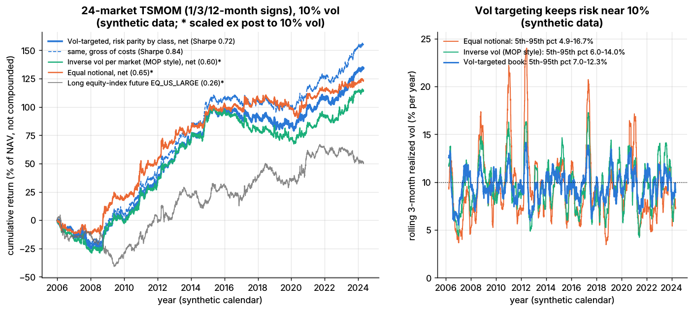
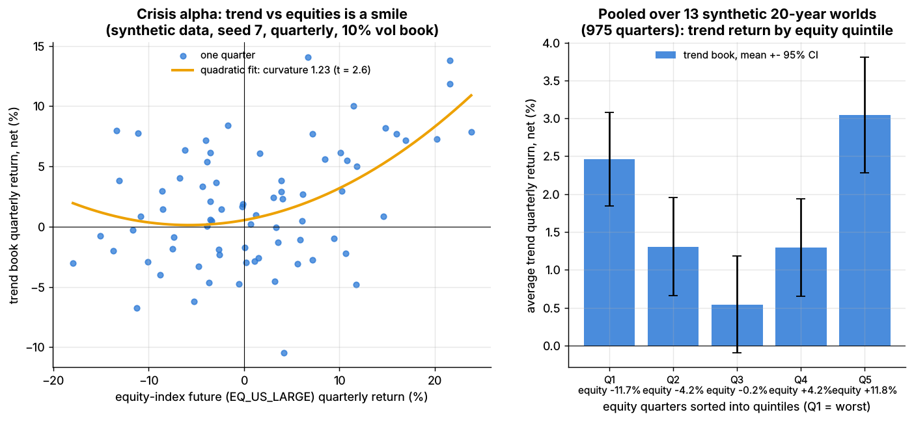

# Lab 19: Trend following with volatility targeting and risk budgeting

## What it demonstrates

- **Time-series momentum (TSMOM)**, as in Moskowitz, Ooi & Pedersen (2012): each market is long
  if its own past return is positive and short if it is negative. The test bed is a synthetic panel of
  **24 futures** (6 equity index, 6 government bond, 6 FX, 6 commodity) over 20 years of daily excess
  returns (`simulate.simulate_futures`). The simulator plants **persistent drift regimes** (mean length
  250 trading days) and nothing else: no carry, no equity premium.
- **The forecast** averages the signs of the past 1-, 3- and 12-month returns, so it takes the values
  -1, -1/3, +1/3 or +1 (`tsmom_signal`).
- **Position sizing, three ways, on the same forecast:**
  1. equal notional per market;
  2. inverse volatility per market (MOP 2012 style: each market sized to 40% ex-ante vol, then 1/N);
  3. the **vol-targeted book** (`vol_target_positions`): an equal risk budget per asset class (risk
     parity across classes), inverse vol within each class, the whole book scaled to a **10% ex-ante
     portfolio vol** using an EWMA covariance matrix, and a per-market cap. A **no-trade buffer**
     (`trade_with_buffer`) then cuts the turnover caused by noise in the vol estimates.
- **Costs**: slippage of 0.5–2 bps of notional per trade plus contract rolls, by asset class
  (stylized; see Key parameters).
- **Crisis alpha**: quarterly trend returns plotted against the equity-index future form a
  **smile**, a convex payoff that does well in large moves in either direction.
- **Truth recovery**: an oracle that knows the sign of the planted drift, and how often the TSMOM sign
  agrees with it.
- **Pitfalls**:
  - the fast 1-month signal loses about a third of its Sharpe to costs;
  - equal notional lets commodities and equities carry over 90% of the risk and lets realized
    vol swing from 5% to 17%;
  - daily rebalancing of a vol-targeted book without a buffer nearly doubles turnover;
  - one 20-year backtest is a noisy estimate: 12 more independent synthetic worlds give net
    Sharpe ratios from 0.43 to 1.04 (10th–90th percentile).

The core of the method, as in `lab.py`:

```python
def tsmom_signal(returns, lookbacks=(21, 63, 252)):
    votes = [np.sign(returns.rolling(L).sum()) for L in lookbacks]   # own past return, per lookback
    return sum(votes) / len(lookbacks)                                # in [-1, +1], known at close t

def vol_target_positions(signal, ann_vol, corr, asset_class, target_vol=0.10, asset_cap=0.40):
    classes, counts = np.unique(asset_class, return_counts=True)
    n_in_class = dict(zip(classes, counts))
    budget = np.array([1.0 / (len(classes) * n_in_class[c]) for c in asset_class])  # risk parity by class
    w = signal * budget / ann_vol                       # inverse vol (notional / NAV)
    port_vol = np.sqrt(w @ (corr * np.outer(ann_vol, ann_vol)) @ w)
    if port_vol > 0:
        w = w * target_vol / port_vol                   # scale the book to the vol target
    cap = asset_cap * target_vol / ann_vol              # max standalone vol per market
    return np.clip(w, -cap, cap)

def trade_with_buffer(target, current, band):           # no-trade zone; trade to its edge only
    gap = target - current
    return np.where(np.abs(gap) > band, target - np.sign(gap) * band, current)
```

## Supports

- [Trend following and CTAs](../../docs/02-strategies/g-futures-and-macro-context/trend-following-and-ctas.md)
- [Position sizing and risk budgeting](../../docs/03-algorithms/d-portfolio-construction/position-sizing-and-risk-budgeting.md)

## How to run

```bash
cd /home/user/quant_trading_claude && export PATH=/home/user/venv-qt/bin:$PATH
python labs/19-trend-following-vol-targeting/lab.py              # full run (~11-16 s): plots + results.json
python labs/19-trend-following-vol-targeting/lab.py --smoke      # CI run (~3 s), writes to labs/_smoke/
python labs/19-trend-following-vol-targeting/lab.py --seed 3     # another synthetic world
```

## Expected output

Full run, seed 7: 24 markets, 5,040 days (20 years), trading from day 257. All Sharpe ratios are
annualized, from synthetic daily returns. "Net" means after slippage and roll costs.

| Book (same 1/3/12-month forecast) | Sharpe gross | Sharpe net | Realized vol | Rolling 3-month vol, 5th–95th pct | Turnover (x NAV per year) |
|---|---|---|---|---|---|
| **Vol-targeted, risk parity by class, 25% buffer** | **0.84** | **0.72** | 9.8% | 7.0–12.3% | 141 |
| same, no buffer | 0.78 | 0.59 | 9.9% | | 252 |
| Inverse vol per market (MOP style)\* | 0.73 | 0.60 | 10.0% | 6.0–14.0% | 165 |
| Equal notional\* | 0.73 | 0.65 | 10.0% | 4.9–16.7% | 72 |

\* No portfolio-level target, so these books are scaled after the fact (with hindsight) to 10%
realized vol to make the curves and costs comparable.

- **Vol targeting delivers the risk it promises.** The vol-targeted book runs at 9.8% realized vol
  with no hindsight. Its rolling 3-month vol stays between 7.0% and 12.3% (5th–95th percentile),
  against 4.9–16.7% for equal notional.
- **Risk budgeting decides who drives P&L.** Under equal notional, commodities and equities carry
  **92%** of the realized risk, while bonds and FX carry 4% each. In the vol-targeted book the class
  shares are equity 36%, rates 25%, commodity 20%, FX 19%. Equities still come out above 25%: the six
  equity indexes are highly correlated (about 0.7), and the class budget ignores correlation within a class.
- **Sizing changes risk more than Sharpe in one sample.** In this seed equal notional happens to
  look fine (0.65 net). Across 12 other worlds its mean net Sharpe is **0.50**, against **0.70** for
  the vol-targeted book.
- **Costs and turnover.** The book trades about 141 times NAV per year, mostly in bond futures. A
  2-year note future with 2% vol needs about 20 times the notional of a gas future for the same
  risk. Mean gross leverage is **3.8x NAV**. Costs drag **1.1% a year** (net Sharpe 0.84 with no
  costs, 0.72 at 1x, 0.61 at 2x, 0.38 at 4x the assumed costs). Without the buffer, turnover is 252x
  and net Sharpe 0.59.
- **Pitfall: speed vs costs.** One lookback at a time, with the same sizing:

  | Lookback | Sharpe gross | Sharpe net | Turnover (x NAV/yr) |
  |---|---|---|---|
  | 1 month (21 d) | 0.52 | 0.36 | 200 |
  | 3 months (63 d) | 0.48 | 0.39 | 113 |
  | 6 months (126 d) | 0.63 | 0.56 | 78 |
  | 12 months (252 d) | 0.88 | 0.82 | 56 |

  In this simulator the 12-month signal alone beats the blend, because the planted regimes last
  250 days on average. Real trend lengths are unknown and vary over time, which is why CTAs blend
  speeds; the blend gives up a little Sharpe here in exchange for that robustness.
- **Truth.** The TSMOM sign agrees with the sign of the true (planted) drift on only **62%** of
  market-days. An oracle that knows the drift sign, sized the same way, earns a gross Sharpe of
  **2.44**, against 0.84 for the real signal. The average single market earns a gross Sharpe of
  just **0.21**, so diversification across 24 markets does most of the work. This matches the
  simulator's calibration of about 0.1–0.2 per market.
- **Crisis alpha (smile).** A regression of quarterly net trend returns on the equity-index future
  (EQ_US_LARGE) and its square gives a curvature of **+1.23 (t = 2.6)**. In the worst 10% of
  equity quarters (mean **-13.4%**) the trend book made **+0.8%**. Pooled over 13 worlds (975
  quarters), the average trend return by equity quintile, worst to best, is **+2.5%, +1.3%, +0.5%,
  +1.3%, +3.0%**. Curvature is positive in 11 of 12 extra worlds, and so is the worst-decile return.
  The quarterly correlation with equities is +0.40 in this seed, so this sample's "crisis alpha"
  comes more from the right wing than the left.
- **Sample noise.** Across the 12 extra worlds, the net Sharpe of the same strategy averages
  **0.70**, with a 10th–90th percentile range of **0.43 to 1.04**. The standard error of a Sharpe
  ratio measured over 20 years is about 1/sqrt(20), roughly 0.22, so one backtest cannot tell
  0.6 from 0.9.



*Left: cumulative net returns of the three sizing schemes and a long equity-index future, all at
about 10% vol (synthetic data). Right: rolling 3-month realized vol; the dotted line is the 10% target.*



*Left: quarterly trend returns vs equity-index returns with a quadratic fit (seed 7). Right:
average trend return by equity-return quintile, pooled over 13 synthetic 20-year worlds.*

## What this toy misses vs the real world

- **Only one source of return.** The simulator plants drift regimes and nothing else. Real futures
  also earn **carry/roll yield** (contango, backwardation, the slope of the yield curve), equities
  earn a risk premium, and bonds benefited from a 40-year rally. Real CTA returns mix trend with
  these premia; here an equity buy-and-hold has a zero expected return.
- **No real crises.** The futures simulator has vol spikes but no planted crash paths, flights to
  quality or correlation breakdowns. The smile here comes only from the mechanics of trend
  following on persistent regimes. Real crisis alpha depends on how crises unfold: a prolonged
  sell-off, like 2008, suits trend, while a sharp V-shaped reversal can catch the book short just
  as the market rebounds.
- **Stylized costs and continuous contracts.** Slippage is a constant number of bps per class. Real
  costs depend on contract, time of day, size relative to depth and market impact, which matters at
  CTA scale. Rolls are charged as a flat cost. Roll timing, roll-period liquidity and calendar-spread
  pricing are not modeled, and futures are treated as continuous excess-return series.
- **No capacity limits, margin or position limits.** Bond futures carry several times NAV of
  notional. Real books face exchange position limits, margin-to-equity budgets and smaller, less
  liquid markets (some commodities, EM FX) where size moves prices.
- **Only 24 markets.** Large CTAs trade many more, including short-term interest rates, credit
  indices and more commodities, which adds diversification. Real correlations also shift over time,
  while the simulator's factor structure is fixed.
- **Ex-ante risk model is simple.** EWMA vols and an EWMA correlation matrix. Real desks blend
  horizons, shrink correlations, stress-test (2022's simultaneous bond and equity losses broke many
  correlation assumptions) and cap leverage and sector risk.
- **No fees.** Fund-level returns after 2-and-20 style or lower management and performance fees are
  materially lower than these net-of-trading-cost numbers.

## Key parameters

All cost and sizing parameters are **stylized**, chosen to be in a realistic range; they are not a
calibration to any broker, exchange or fund.

| Parameter | Value | Meaning |
|---|---|---|
| Markets | 24 (6 per class), 5,040 days (smoke: 2,016) | `simulate_futures(seed)`; annual vols from 2% (2-year note) to 45% (natural gas) |
| `trend_strength`, `regime_days` | 0.045, 250 | simulator defaults: drift std in units of daily vol; mean regime length |
| `lookbacks` | 21, 63, 252 days | 1, 3 and 12 months; forecast = mean of signs |
| Vol estimate | EWMA of squared returns, center of mass 60 days | as in MOP (2012); annualized with sqrt(252) |
| Correlation estimate | EWMA, span 250 days | used for the portfolio vol target |
| `target_vol` | 10% per year | ex-ante portfolio vol target |
| Risk budget | 25% per asset class, equal within class | risk parity across classes |
| `asset_cap` | 0.40 | max standalone vol per market = 40% of the target (4% of NAV); a safety rail that binds on only 0.09% of market-days here |
| Buffer | 25% of the market's typical position (EWMA of absolute target, ~100-day memory) | no-trade band; trade to its edge |
| MOP-style book | 40% ex-ante vol per market, 1/N weights | Moskowitz, Ooi & Pedersen (2012) convention |
| Slippage | equity 1.0, rates 0.5, FX 0.5, commodity 2.0 bps of notional per trade | stylized half-spread + slippage `[Estimate]` |
| Rolls | 4 per year (equity, rates, FX), 8 (commodity); each costs one slippage unit | stylized `[Estimate]` |
| Extra worlds | 12 seeds (smoke: 2) | robustness and pooled smile |

Sources. Bibliographic details checked against Crossref (2026-11).

- [Verified] Moskowitz, T. J., Ooi, Y. H. & Pedersen, L. H. (2012). "Time series momentum." *Journal of Financial Economics* 104(2), 228–250. <https://doi.org/10.1016/j.jfineco.2011.11.003> (accessed 2026-11)
- [Verified] Hurst, B., Ooi, Y. H. & Pedersen, L. H. (2017). "A Century of Evidence on Trend-Following Investing." *The Journal of Portfolio Management* 44(1), 15–29. <https://doi.org/10.3905/jpm.2017.44.1.015> (accessed 2026-11)
- [Verified] Fung, W. & Hsieh, D. A. (2001). "The Risk in Hedge Fund Strategies: Theory and Evidence from Trend Followers." *Review of Financial Studies* 14(2), 313–341. <https://doi.org/10.1093/rfs/14.2.313> (accessed 2026-11)
