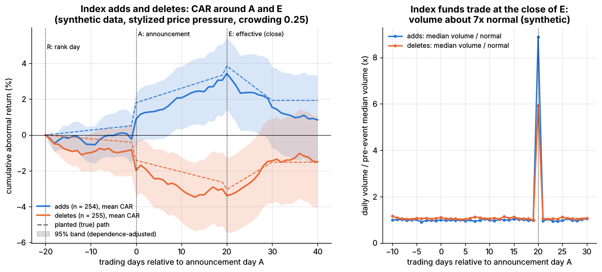
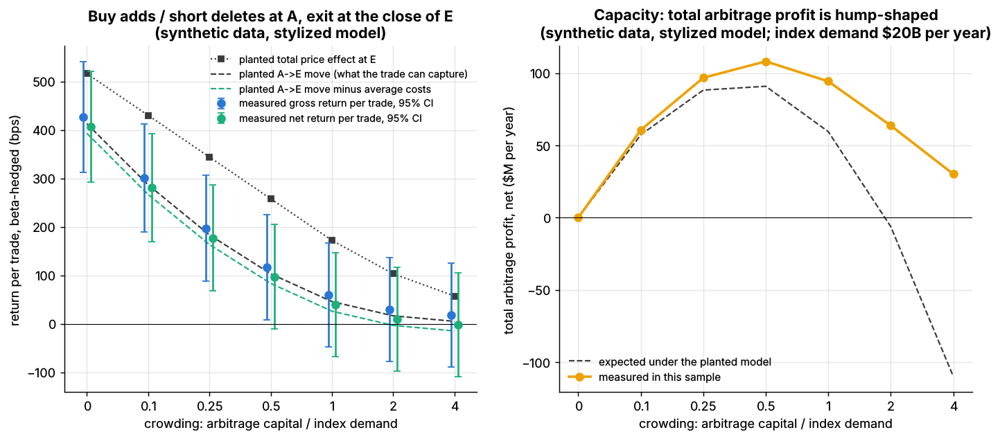

# Lab 20: Index reconstitution event study and the cost of crowding

## What it demonstrates

- **A synthetic, Russell-style annual reconstitution.** The universe is 800 simulated stocks over
  10 years (`simulate.simulate_equity_market`, with no planted stock alphas). On each rank day
  **R**, stocks are ranked by market cap. The index holds the top 400, with a ±10-rank band to limit
  turnover: a non-member joins if it ranks in the top 390, and a member leaves if it falls below 410.
  The add and delete lists are announced on day **A** = R + 20 trading days and take effect at the
  close of day **E** = A + 20. Nine reconstitutions produce **254 adds and 255 deletes**.
- **A stylized price-pressure model planted on top of the simulated returns** (see Key parameters;
  not calibrated to any real index). Index funds must trade 4% of each changed stock's shares at
  the close of E. Before that:
  - a total price effect builds up and shrinks as **arbitrage capital** (crowding) grows;
  - part of the effect comes early: an anticipation drift from R and a jump on A;
  - the rest drifts into E, with a final push in E's closing auction;
  - half of the total reverses over the 10 days after E;
  - E-day volume spikes to about **7.5x** normal.
- **An event study.** Market-model abnormal returns (AR) and cumulative abnormal returns (CAR) around
  A and E, for adds and deletes, with 95% bands using the Brown & Warner (1985) crude dependence
  adjustment. The results are checked against the planted path.
- **The classic trade.** Buy adds and short deletes at the close of A, hedge with beta x index, and
  exit into the closing auction at E. Costs are spread, entry impact and borrow fees. The lab then
  shows how the trade's P&L shrinks as crowding grows, and that total arbitrage profit is
  hump-shaped (capacity).
- **Pitfalls:**
  - **Selection.** Stocks are added *because* they rose. Their beta-adjusted CAR over the year before
    R is **+38%** (deletes **-34%**), and none of it is an index effect.
  - **The market-model intercept.** An alpha estimated over that pre-event year converts the run-up
    into a fake daily alpha and shifts the 60-day CAR by **-9.2 pp** for adds (+8.1 pp for deletes),
    far more than the effect itself.
  - **Clustered events.** All adds in a year share calendar dates. Naive cross-sectional standard
    errors are about 1.4x too small, and their bands miss the true path on 15% of days for deletes.
  - **Holding past E** gives back the reversal: the trade turns from **+177** to **-50** bps net.

The core of the method, as in `lab.py`:

```python
def abnormal_returns(returns, market, events, window=(-20, 40), est_window=(-270, -21), intercept=False):
    rel, est = np.arange(window[0], window[1] + 1), np.arange(est_window[0], est_window[1] + 1)
    ar, ar_est = [], []
    for stock, d0 in zip(events["stock"], events["day0"]):        # d0 = row of day 0 (A)
        r_e, m_e = returns[d0 + est, stock], market[d0 + est]
        beta = np.cov(r_e, m_e)[0, 1] / np.var(m_e, ddof=1)
        alpha = (r_e.mean() - beta * m_e.mean()) if intercept else 0.0   # default: drop alpha
        ar.append(returns[d0 + rel, stock] - alpha - beta * market[d0 + rel])
        ar_est.append(r_e - alpha - beta * m_e)
    return np.array(ar), np.array(ar_est)

def event_study(ar, ar_est, window=(-20, 40)):
    n = ar.shape[0]
    car_i = np.cumsum(np.c_[np.zeros(n), ar[:, 1:]], axis=1)       # each event's CAR, 0 at window start
    car = car_i.mean(axis=0)
    se_cross = car_i.std(axis=0, ddof=1) / np.sqrt(n)              # assumes independent events
    se_dep = ar_est.mean(axis=0).std(ddof=1) * np.sqrt(np.arange(ar.shape[1]))   # Brown-Warner
    se = np.maximum(se_cross, se_dep)
    return pd.DataFrame({"car": car, "se_cross": se_cross, "se_dependence": se_dep,
                         "lo": car - 1.96 * se, "hi": car + 1.96 * se}, index=np.arange(window[0], window[1] + 1))
```

## Supports

- [Flow-driven strategies](../../docs/02-strategies/d-mid-frequency-alpha/flow-driven-strategies.md)

## How to run

```bash
cd /home/user/quant_trading_claude && export PATH=/home/user/venv-qt/bin:$PATH
python labs/20-index-reconstitution-event-study/lab.py              # full run (~4 s): plots + results.json
python labs/20-index-reconstitution-event-study/lab.py --smoke      # CI run (~2 s), writes to labs/_smoke/
python labs/20-index-reconstitution-event-study/lab.py --seed 3     # another synthetic market
```

## Expected output

Full run, seed 7: 800 stocks, 2,520 days, 9 reconstitutions, 254 adds and 255 deletes. Base case
crowding = 0.25, meaning arbitrage capital equals 25% of index demand. The CARs are in percent,
measured with the market model (beta only, no alpha), with the planted (true) value in brackets.

| Window (trading days) | Adds: measured (true) | Deletes: measured (true) |
|---|---|---|
| Anticipation, R to A (days -19..-1) | -0.23 (+0.51) | -0.82 (-0.41) |
| Announcement day A | +1.12 (+1.28) | -1.15 (-1.01) |
| Run-up A to E (days 1..20), what the trade earns | +2.54 (+2.05) | -1.40 (-1.62) |
| of which effective day E | +0.38 (+0.51) | -0.37 (-0.41) |
| Reversal, E to E + 20 | -2.59 (-1.93) | +1.88 (+1.52) |
| Total, R to E + 20 | +0.84 (+1.93) | -1.50 (-1.52) |

- **Recovery of the truth.** The dependence-adjusted 95% band contains the planted CAR path on
  98% (adds) and 100% (deletes) of the 61 event days. Individual windows miss the truth by up to
  about 1 pp; over 20–60 days a mid-cap stock's idiosyncratic noise is several percent, and there
  are only ~250 events per side. The ±2.5 pp band at E + 20 is as wide as the planted permanent
  effect: an event study this size can clearly see the run-up and the reversal, but not pin down
  how much of the effect is permanent.
- **Calendar clustering.** The Brown & Warner standard error is a median **1.38x** the naive
  cross-sectional one. Naive bands would cover the truth on only 93% (adds) and 85% (deletes) of days.
- **Volume.** Index demand is 4% of shares outstanding, a median 5.8 days of normal volume
  (10th–90th percentile 2.8–11.9 days). At the close of E, volume is a median **7.5x** the
  pre-event normal (adds about 9x, deletes about 6x).
- **The trade at base crowding.** Each trade buys an add (or shorts a delete) at the close of A,
  hedges with beta x index, and exits at the close of E. It earns **197 bps gross and 177 bps net
  per trade**, with a 95% CI of ±109 bps clustered by reconstitution; 63% of trades make money.
  Round-trip costs average 20 bps (spread + 10 bps entry impact + borrow on shorts). Holding to
  E + 20 instead gives **-50 bps** net: the reversal eats the run-up.
- **Crowding.** The same simulated returns are used at every crowding level (common random
  numbers), so the differences between levels are precise even though each level's CI is wide.

  | Crowding (arb capital / index demand) | 0 | 0.1 | 0.25 | 0.5 | 1 | 2 | 4 |
  |---|---|---|---|---|---|---|---|
  | Planted total price effect at E (bps) | 517 | 430 | 344 | 258 | 172 | 103 | 57 |
  | Planted A-to-E move the trade can capture (bps) | 413 | 287 | 184 | 103 | 46 | 17 | 5 |
  | Measured net return per trade (bps) | 407 | 281 | 177 | 97 | 39 | 10 | -1 |
  | Expected total arbitrage profit ($M/yr) | 0 | 57 | 88 | 91 | 60 | -6 | -110 |

  As arbitrage capital grows, the total effect shrinks and more of what remains happens *before*
  the trade can be put on (anticipation and the A-day jump). The marginal arbitrageur's net return
  falls from 4% per trade to about zero. Total profit of all arbitrageurs (capital x net return,
  with \$20B a year of index demand) peaks at a crowding of about 0.5 and turns negative near 2.
  The measured curve sits above the expected one at high crowding. The reason is a sample error of
  about +14 bps per trade, which is multiplied by large capital.
- **Selection and intercept pitfalls.** The beta-adjusted CAR over the year before R is **+38.3%**
  for adds and **-33.9%** for deletes. A market model with an estimated intercept shifts the total
  CAR by **-9.2 pp** (adds) and **+8.1 pp** (deletes), turning a positive add effect into a large
  negative one.



*Left: mean CAR of adds and deletes with 95% dependence-adjusted bands; dashed lines are the
planted paths (synthetic data, stylized price-pressure model). Right: median daily volume relative
to the pre-event median, with the spike in the closing auction on E.*



*Left: return per trade of the buy-at-A / sell-at-E trade vs arbitrage capital (planted
expectation and measured values with 95% CIs). Right: total arbitrage profit per year, expected
and measured.*

## What this toy misses vs the real world

- **The price-pressure model is assumed, not estimated.** Its shape and size (5% with no arbitrage,
  half of it reversing) are stylized. Real index effects vary by index family, era, stock size,
  and the ratio of index demand to float and volume. Greenwood & Sammon (2025) report that the
  average S&P 500 inclusion return fell from 7.4% in the 1990s to under 1% in the last decade
  `[Verified]`. They investigate several drivers; the lab's crowding channel is one stylized
  mechanism, not their conclusion.
- **Real rules are richer.** The Russell, S&P and MSCI methodologies differ: committees vs rules,
  float adjustment, banding, sector balance, IPO additions and migrations between indices, and
  they change over time (banding, reconstitution frequency, float treatment). Here every index
  weight is proportional to cap, and only the top-N cutoff matters.
- **Predictability is assumed, not modeled.** Real arbitrageurs estimate the add and delete lists
  from public rules before A, with errors, and the S&P committee's choices are only partly
  predictable. In the toy, the lists are known for sure at A.
- **No market impact from the arbitrageurs' own trades.** The trade is evaluated for a small
  arbitrageur paying a fixed 10 bps entry impact. Large arbitrage capital moves prices, but that is
  folded into the stylized "early share" rather than into each fund's trading costs.
- **Closing-auction mechanics are missing.** The real E-day trade depends on auction imbalance
  publications, order types, and the auction price itself. Index funds also do not all trade at the
  close; some pre-trade or use transition managers, which spreads the demand.
- **Other news is ignored.** Real adds and deletes coincide with earnings, M&A (a common reason
  for S&P deletions) and momentum, which confound event studies. This toy removes the simulator's
  planted alphas so that the index effect is the only predictable return.
- **No short constraints beyond a flat borrow fee.** Deleted, falling stocks can be hard or
  expensive to borrow, which limits the delete side in practice.

## Key parameters

All price-pressure, demand and cost parameters are **stylized**; none is a calibration to a
real index.

| Parameter | Value | Meaning |
|---|---|---|
| Universe | 800 stocks x 2,520 days (smoke: 300 x 800) | `simulate_equity_market(alphas=())`: no planted stock alphas |
| Index | top 400 by market cap, ±10-rank band | adds: non-members ranked ≤ 390; deletes: members ranked > 410 |
| Calendar | R every 252 days from day 260; A = R + 20; E = A + 20 | annual, Russell-style; effective at the close of E |
| Event window / estimation window | days -20..+40 / -270..-21 relative to A | estimation ends the day before R |
| `P0` | 5% | total price effect at E with no arbitrage capital, scaled per stock by sqrt(index demand in days of ADV / median), clipped to 0.5–2x |
| `C_HALF` | 0.5 | crowding at which the total effect halves: total = P0 / (1 + c / C_HALF) |
| `EARLY_SHARE_0` | 20% | share realized by the close of A with no arbitrage capital; rises to 100% as crowding grows, half as anticipation and half as the A-day jump |
| `E_DAY_SHARE` | 25% | share of the A-to-E drift that lands on day E |
| `REVERSAL` | 50% over 10 days | share of the total effect that reverses after E (between full reversal and none) |
| `PASSIVE_SHARE` | 4% of shares outstanding | index demand traded at the close of E (volume spike) |
| Base crowding | 0.25 | arbitrage capital / index demand in the event study |
| Costs | full quoted spread (2–15 bps for these stocks, median 5.6) + 10 bps entry impact; borrow 100 bps/yr on shorts | round trip, average 20 bps `[Estimate]` |
| Strategy | long adds / short deletes at the close of A, exit at the close of E, beta-hedged | equal weight per event |

Sources. Bibliographic details checked against Crossref (2026-11).

- [Verified] Harris, L. & Gurel, E. (1986). "Price and Volume Effects Associated with Changes in the S&P 500 List: New Evidence for the Existence of Price Pressures." *The Journal of Finance* 41(4), 815–829. <https://doi.org/10.1111/j.1540-6261.1986.tb04550.x> (accessed 2026-11)
- [Verified] Shleifer, A. (1986). "Do Demand Curves for Stocks Slope Down?" *The Journal of Finance* 41(3), 579–590. <https://doi.org/10.1111/j.1540-6261.1986.tb04518.x> (accessed 2026-11)
- [Verified] Greenwood, R. & Sammon, M. (2025). "The Disappearing Index Effect." *The Journal of Finance* 80(2), 657–698 (online 2024-12; NBER WP 30748, 2022). <https://doi.org/10.1111/jofi.13410> (accessed 2026-11)
- [Verified] Brown, S. J. & Warner, J. B. (1985). "Using daily stock returns: The case of event studies." *Journal of Financial Economics* 14(1), 3–31. <https://doi.org/10.1016/0304-405X(85)90042-X> (accessed 2026-11)
- [Verified] Madhavan, A. (2003). "The Russell Reconstitution Effect." *Financial Analysts Journal* 59(4), 51–64. <https://doi.org/10.2469/faj.v59.n4.2545> (accessed 2026-11)
- [Verified] Chen, H., Noronha, G. & Singal, V. (2004). "The Price Response to S&P 500 Index Additions and Deletions: Evidence of Asymmetry and a New Explanation." *The Journal of Finance* 59(4), 1901–1930. <https://doi.org/10.1111/j.1540-6261.2004.00683.x> (accessed 2026-11)
- [Verified] Petajisto, A. (2011). "The index premium and its hidden cost for index funds." *Journal of Empirical Finance* 18(2), 271–288. <https://doi.org/10.1016/j.jempfin.2010.10.002> (accessed 2026-11)
